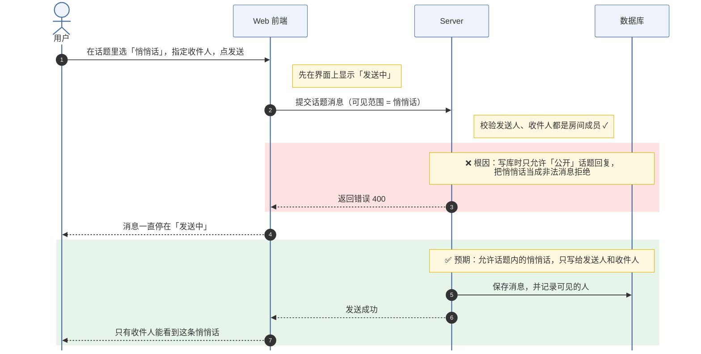
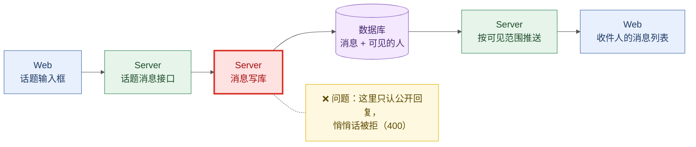

# 根因图规范

每条 Bug 两张图，Mermaid 源码渲染成 PNG 上传到「根因图」。目标是 RD 不看代码、扫一眼就懂：**谁做了什么、哪一步出错、应该怎样**。

通用要求：

- 文字用大白话，不用类名、函数名、错误码常量（`WriteOwner`、`RootInvalid` 这类放到根因细节里）；每个框、每条箭头不超过 20 个字。
- 只画和这个 Bug 相关的部分：流程图不超过 10 步，架构图不超过 8 个节点。
- 字号统一 18px（见下面模板的 `init`），渲染用 `render.py`（2 倍清晰度）。
- 最新 main 已修复时，图里画「问题」和「预期」两段，不画代码版本细节。

## 流程图 `flow.mmd`：时序图

用 `sequenceDiagram`，按端分泳道（用户 / Web 前端 / Server / WebSocket / Computer / 数据库，用到哪个画哪个），和根因里的「预期工作流程」一一对应。

- 消息箭头写「做了什么」；一端内部的动作用 `Note right of X`，不要用自己指向自己的箭头（标签会压住序号）。
- 出错的那一段用红色 `rect rgb(253, 226, 225)` 包起来，里面一条 `Note` 写「❌ 根因：……」。
- 预期的那一段用绿色 `rect rgb(230, 244, 234)` 包起来，`Note` 写「✅ 预期：……」。



## 架构图 `arch.mmd`：一行链路

用 `flowchart LR` 画一条从左到右的链路，节点第一行写端名、第二行写组件的通俗名字；用颜色区分端，问题所在的组件标红，问题说明挂在它旁边的黄色注释里。**不要**用 `subgraph` 分组、不要画回头的连线（Mermaid 排版会交叉、拉长）。



颜色：Web 蓝 `web`、Server 绿 `srv`、WebSocket 青 `ws`、Computer 橙 `pc`、数据库紫 `db`、问题红 `bug`、说明黄 `note`。方案要改的组件可以再挂一条 `note` 写「改动：……」。

## 渲染

```sh
python3 scripts/render.py --input flow.mmd --input arch.mmd
```

渲染后**自己打开 PNG 看一遍**：文字有没有重叠、线有没有交叉、红色是不是落在出错的那一步。不清楚就改源码重渲染。失败时返回 mmdc 的报错（行号与原因）；节点文字里有括号、引号或 `|` 时用双引号包起来，如 `A["调用 get(id)"]`。
