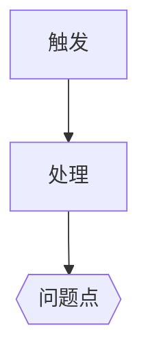
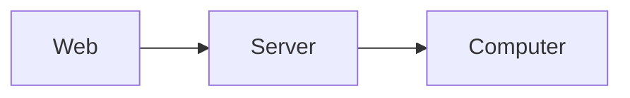

问题与目标：<根因一句话；修复后期望的行为；本次修改的边界>

根本方案：
- 做法：<如何从根上消除原因>
- 改动：<模块、接口、状态处理>
- 兼容性与风险：<……>
- 回滚：<……>

兼容方案：
- 做法：<……>
- 改动：<……>
- 兼容性与风险：<……>
- 回滚：<……>

取舍：<覆盖范围、架构影响、改动成本、回归风险的对比；两个方案相同时说明原因>

选定方案：<根本／兼容；RD 的约束和要求>

修改范围：
- tutti：<文件或模块、实现要点>
- tutti-server：<……>
- tsh-websocket：<……>
- 测试：<要补的单测或集成测试>

工作流程图：

架构图：

已知风险：<……>
