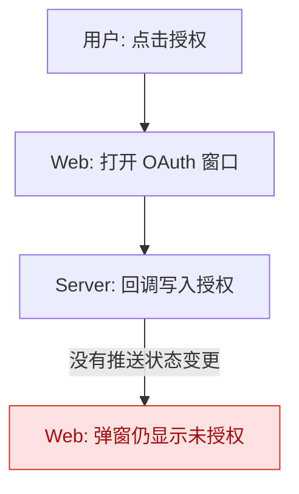
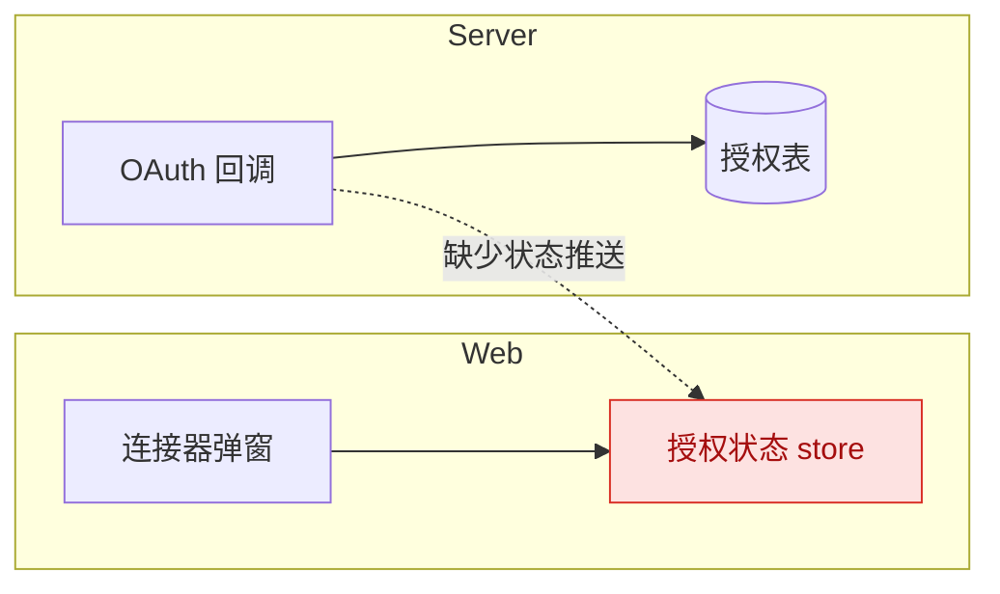

# 根因图规范

每条 Bug 两张图，Mermaid 源码渲染成 PNG 上传到「根因图」。

## 流程图 `flow.mmd`

和根因里的「预期工作流程」一一对应：从用户操作开始，经过前端、服务端、WebSocket、Computer 的关键步骤，到用户看到的现象；实际偏离的那一步标红。

- 用 `flowchart TD`；节点写清「谁做了什么」，如 `Web: 打开授权弹窗`。
- 出错的那一步用 `:::bug` 标红，并在连线上写出错原因。
- 只画和这个 Bug 相关的路径，10–20 个节点为宜。



## 架构图 `arch.mmd`

涉及的组件和调用关系：前端模块、服务端服务、Computer、外部依赖，以及它们之间的接口或消息。

- 用 `flowchart LR`，按端分 `subgraph`（Web／Server／Computer／外部）。
- 问题所在的组件或接口用 `:::bug` 标红；方案要改动的位置用 `:::change` 标出。



## 渲染

```sh
python3 scripts/render.py --input flow.mmd --input arch.mmd
```

失败时返回 mmdc 的报错（行号与原因），改源码后重渲染。常见问题：节点文字里有括号、引号或 `|` 时用双引号包起来，如 `A["调用 get(id)"]`。
